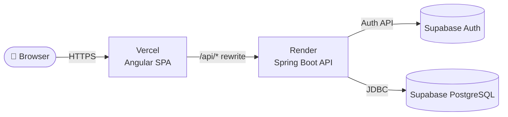
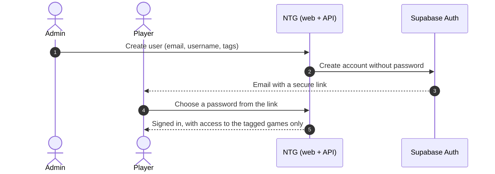

<div align="center">

# 🎮 NTG System 🎮

**A private platform where a group of friends tracks, organizes and plays everything around the games we share.**


[Overview](#-overview) · [Features](#-features) · [Architecture](#-architecture) · [Tech stack](#-tech-stack) · [Repository layout](#-repository-layout) · [Documentation](#-documentation)

</div>

<br>

---

# ✨ Overview

NTG System is a full-stack web application built for a closed group of friends. It centralizes the data and
tools of the games we play together, and it is designed so that new games can be plugged in as independent
modules as they are developed.

- 🔒 **Invitation-only.** There is no public sign-up: an admin creates each account and the user receives an
  email to choose their own password.
- 🏷️ **Access by tags.** Every game is unlocked with a tag. Users only see (and can only call the API of) the
  games they have been given access to.
- 🧩 **Modular by design.** A game is one feature folder in the frontend and one Maven module in the backend.
- 🛡️ **Security-first API.** Deny-by-default authorization, locally verified tokens, HttpOnly session cookie
  and no internal details leaked in errors.

> This is a personal full-stack project. The site itself is private; this repository documents how it is
> built.

<br>

---
# 🚀 Features

| 👑 Admin | 🎮 Player |
|---|---|
| Create users with just an email and a username | Sign in once and stay signed in across visits |
| Assign or remove **tags** to grant or revoke access to games | See only the games they have access to |
| Resend the "choose your password" email | Open the content and tools of every game they can access |
| Platform dashboard with user statistics | Edit their own profile |
| Manage the content of each game from the admin area | Follow the activity of the games they take part in |

### 🧪 Game modules

| Game | Status | Highlights |
|---|---|---|
| **Available games** | ✅ Live | Each game ships its own content, rules and tools behind its access tag |
| **Upcoming games** | 🛠️ Planned | New games are added over time as they are developed; the tag and module system is ready for them |

<br>

---
# 🏗️ Architecture



- The browser only ever talks to the website's own domain. Vercel forwards `/api/*` to the backend, so the
  session cookie is **first-party** and the backend address never appears in the web app.
- **Supabase Auth** is the identity provider (credentials, email delivery, password setup). The backend adds
  the application rules on top: roles, tags and game access.
- **PostgreSQL** (Supabase) stores the application data in one schema for the platform, `core` (users, tags),
  plus one schema per game module.

### How a new user joins



<br>

---
# 🧰 Tech stack

| Layer | Technology |
|---|---|
| **Frontend** | Angular 21 (standalone, zoneless, signals), TypeScript 5.9, RxJS, SCSS design tokens |
| **Backend** | Java 25, Spring Boot 4, Spring Security, Spring Data JPA, Bean Validation, springdoc OpenAPI |
| **Identity** | Supabase Auth (JWT access tokens, rotating refresh tokens) |
| **Database** | PostgreSQL on Supabase |
| **Build & deploy** | Maven multi-module, multi-stage Docker image, Render (API), Vercel (SPA) |

<br>

---
# 📁 Repository layout

```text
NTG/
├── backend/     Spring Boot API · Maven multi-module (core + one module per game)
└── frontend/    Angular single-page application
```

<br>

---
# 📚 Documentation

| | |
|---|---|
| 🖥️ [**Frontend**](./frontend/README.md) | Screens, routing and access, session handling, folder structure and conventions |
| ⚙️ [**Backend**](./backend/README.md) | Folder structure, security model, account and session flows, API overview, deployment |

<br>

---
# 👤 Author

[@adrianpmdev](https://github.com/adrianpmdev) · Junior Full Stack Developer 
