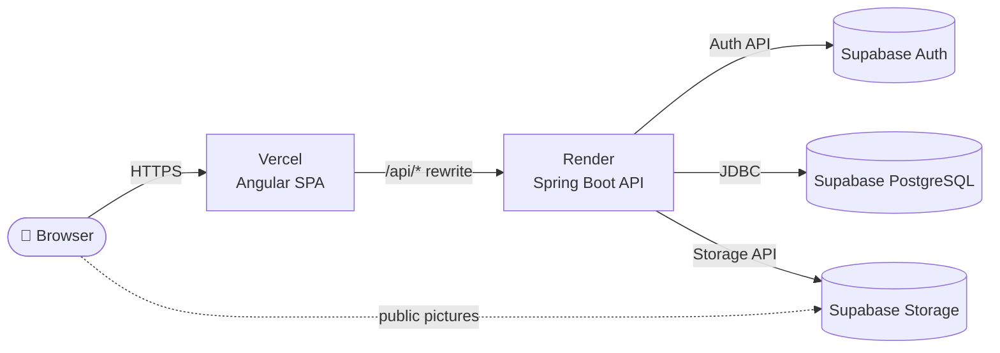
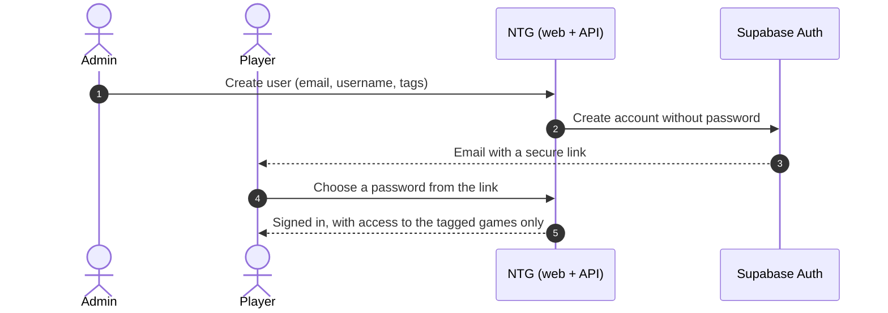

<div align="center">

# 🎮 NTG System 🎮

### A private platform where a group of friends tracks, organizes and plays everything around the games we share


[](https://github.com/adrianpmdev)

[Overview](#-overview) · [Features](#-features) · [Architecture](#-architecture) · [Tech stack](#-tech-stack) · [Repository layout](#-repository-layout) · [Documentation](#-documentation) · [License](#-license)

</div>

---

<br>

## ✨ Overview

NTG System is a full-stack web application built for a closed group of friends. It centralizes the data and
tools of the games we play together, and it is designed so that new games can be plugged in as independent
modules as they are developed.

- 🔒 **Invitation-only.** There is no public sign-up: an admin creates each account and the user receives an
  email to choose their own password.
- 🏷️ **Access by tags.** Every game is unlocked with a tag. Users only see (and can only call the API of) the
  games they have been given access to.
- 🧩 **Modular by design.** A game is one Maven module in the backend and one folder in the frontend. Games never
  depend on each other, and the platform never names a game: each one declares itself.
- 🛡️ **Security-first API.** Deny-by-default authorization, locally verified tokens, HttpOnly session cookie,
  limits on sign-in attempts, strict browser security headers and no internal details leaked in errors.
- 🪶 **Built for free tiers.** Caches, compressed and conditional responses and a lean deployment keep the
  site well inside the free plans of Render, Vercel and Supabase.
- 📱 **Every screen works on phones.** Layouts were checked screen by screen from 320 px to desktop.

> 🔒 **This is a personal full-stack project.** The site itself is private; this repository documents how it is
> built.

---

<br>

## 🚀 Features

| 👑 Admin | 🎮 Player |
|---|---|
| Create users with just an email and a username | Sign in once and stay signed in across visits |
| Assign or remove **tags** to grant or revoke access to games | See only the games they have access to |
| Resend the "choose your password" email | Open the content and tools of every game they can access |
| Manage the **game catalog**: add games, order them, release them | Follow the activity of the games they take part in |
| Upload **pictures** (covers, game icons, game artwork): the server compresses them | Upload their own team pictures where a game allows it |
| Manage the content of each game from the admin area | |

### 🧪 Game modules

| Game | Status | Highlights |
|---|---|---|
| **Available games** | ✅ Live | Each game ships its own content, rules and tools behind its access tag |
| **Upcoming games** | 🛠️ Planned | Listed as "coming soon" in the catalog; released from the admin area without a deploy |

---

<br>

## 🏗️ Architecture



- The browser only ever talks to the website's own domain. Vercel forwards `/api/*` to the backend, so the
  session cookie is **first-party** and the backend address never appears in the web app.
- **Supabase Auth** is the identity provider (credentials, email delivery, password setup). The backend adds
  the application rules on top: roles, tags and game access.
- **PostgreSQL** (Supabase) stores the application data in one schema for the platform, `core` (users, tags,
  game catalog, pictures), plus one schema for each game that needs tables.
- **Supabase Storage** keeps the pictures. Only the backend writes; public pictures are downloaded straight from
  Supabase, and private ones through short-lived signed links.
- **The backend is the single source of data.** The web client only shows what the API sends, so another client
  could be built on the same API.

### How a new user joins



---

<br>

## 🧰 Tech stack

| Layer | Technology |
|---|---|
| **Frontend** | Angular 21 (standalone, zoneless, signals), TypeScript 5.9, RxJS, SCSS design tokens |
| **Backend** | Java 25, Spring Boot 4, Spring Security, Spring Data JPA, Bean Validation, springdoc OpenAPI, Caffeine, Bucket4j |
| **Identity** | Supabase Auth (JWT access tokens, rotating refresh tokens) |
| **Database & files** | PostgreSQL and Storage on Supabase |
| **Build & deploy** | Maven multi-module, multi-stage Docker image, Render (API), Vercel (SPA) |

---

<br>

## 📁 Repository layout

```text
NTG/
├── backend/            Spring Boot API · Maven multi-module
│   ├── platform-api/   Contracts shared by the platform and the games
│   ├── core/           Identity, security, catalog, pictures (+ sql/core.sql)
│   ├── games/          One module per game (+ its own sql/ when it has tables)
│   └── app/            Boots everything and builds the runnable jar
├── frontend/           Angular single-page application (src/app/games: one folder per game)
└── docs/               Technical manual
```

---

<br>

## 📚 Documentation

| | |
|---|---|
| 🖥️ [**Frontend**](./frontend/README.md) | Screens, routing and access, session handling, folder structure, responsive design and conventions |
| ⚙️ [**Backend**](./backend/README.md) | Modules, security model, account and session flows, API overview, data model, deployment |
| 📘 **Technical manual** | `docs/NTG — Technical Manual.docx`: the full reference, including how each game works and how to add a new one |

---

<br>

## 📄 License

Proprietary source code: the repository is public for portfolio presentation and professional evaluation only. Third-party data, trademarks and game content keep their own licenses and rights. See [LICENSE](LICENSE) for details.

---

<br>

## 👤 Author

[@adrianpmdev](https://github.com/adrianpmdev) · Junior Full Stack Developer

---

<br>

<div align="center">

✨ Made in **2026** by [@adrianpmdev](https://github.com/adrianpmdev) ✨

</div>
