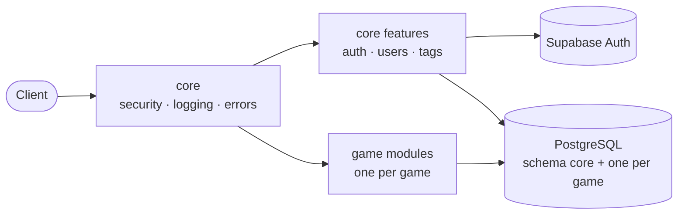

<div align="center">

# ⚙️ NTG System · Backend ⚙️

**REST API that handles identity, access control and the data of every game module.**


[Overview](#-overview) · [Folder structure](#-folder-structure) · [Security](#-security) · [Main flows](#-main-flows) · [API](#-api-overview) · [Data model](#-data-model) · [Errors & logs](#-errors-and-logging) · [Run & deploy](#-run-and-deploy)

↩️ [Back to the project overview](../README.md)

</div>

<br>

---
# ✨ Overview

The backend is a **Spring Boot** application split into two Maven modules:

| Module | Role |
|---|---|
| 🚀 **`core`** | The runnable application. Owns identity (users, tags), the Supabase integration, security, logging and error handling. |
| 🎮 **Game modules** | One module per game, each with its own domain and REST endpoints. A game module contains **no security code**: `core` decides who can reach it. |



Adding a new game means adding a new module next to the existing game modules and registering its path and tag in
the security rules. Nothing else in the platform changes.

<br>

---
# 📁 Folder structure

The code is **feature-first**: each feature owns everything it needs, split into three layers.

```text
backend/
├── pom.xml                         Parent POM: Java 25, Spring Boot dependency management, modules
├── Dockerfile                      Multi-stage build (Maven + JDK → slim JRE image)
│
├── core/                           🚀 Runnable application: platform, identity and security
│   └── src/main/java/com/adrianpmdev/core/
│       ├── Application.java        Entry point (also loads the game modules)
│       ├── config/                 Typed settings, OpenAPI, shared HTTP client
│       │
│       ├── security/               🛡️ Who you are and what you may do
│       │   ├── config/             Security chains, CORS, token decoder
│       │   ├── authentication/     Authenticated-user principal, Swagger admin login
│       │   ├── authorization/      Roles and tag-based authorities
│       │   ├── cookie/             Session (refresh token) cookie
│       │   └── filter/             Bearer token filter
│       │
│       ├── web/                    Health endpoint and global error handling
│       ├── logging/                Request id and access log
│       ├── integration/supabase/   🔌 Supabase Auth client, DTOs and settings
│       │
│       └── features/               Business features
│           ├── auth/               Login, refresh, logout, set password
│           ├── users/              User management and tag assignment
│           └── tags/               Tag management
│
└── <game>/                         🎮 One module per game: domain and REST, no security code
    └── src/main/java/com/adrianpmdev/<game>/features/
        └── <feature>/              One folder per feature of the game
```

### Inside every feature

```text
<feature>/
├── api/                            🌐 What the outside world sees
│   ├── controller/                 REST endpoints
│   ├── dto/request/                Validated input
│   ├── dto/response/               Explicit output (entities are never exposed)
│   ├── mapper/                     Entity ⇄ DTO conversion
│   └── validation/                 Custom validators (only where needed)
├── application/                    🧠 What the feature does
│   └── service/                    Business rules and orchestration
└── infrastructure/                 🗄️ How it is stored
    └── persistence/
        ├── entity/                 JPA entities
        └── repository/             Spring Data repositories
```

**Rules that keep it tidy**

- Controllers never touch repositories: they call services, and services own the business rules and talk to the
  repositories and to the Supabase client.
- Requests are validated at the edge and responses are DTOs, so the database model never leaks into the API.
- Game modules never depend on `core`'s security: the access policy lives in one place.

<br>

---
# 🛡️ Security

Security is the most carefully designed part of the backend. Every request goes through the same pipeline:
request id and access log → CORS allow-list → optional bearer token (verified locally, role and tags loaded from the
database) → deny-by-default authorization rules → controller. Requests that are not signed in receive `401` and
requests without permission receive `403`.

| 🔐 Concern | How it is handled |
|---|---|
| **Identity** | Delegated to **Supabase Auth**. The backend never stores passwords. |
| **Token verification** | Access tokens (JWT) are verified **locally** (signature, expiry, issuer) against Supabase's keys: no network call per request. |
| **Fresh permissions** | Role and tags are read from the database on every request, so removing a tag or deleting a user takes effect **immediately**, not when the token expires. |
| **Authorization** | **Deny by default.** Every route must be listed explicitly; anything not listed is rejected. Routes are grouped by role (`ADMIN`) and by game tag. |
| **Game access** | Reading a game's endpoints needs its **tag** (or admin). Writing needs **admin**. The rule is defined once per game, by path. |
| **Sessions** | Short-lived access token kept in memory by the client, plus a long-lived **refresh token in an HttpOnly cookie** (scoped to the auth path, `Secure` and `SameSite` configurable). The refresh token **rotates** on every use and logout revokes it on Supabase. |
| **Accounts** | **No public sign-up.** Only admins create users, and users choose their own password from a one-time email link. An admin cannot delete their own account. |
| **Passwords** | Policy enforced on the way in (length, at least a letter and a number, any characters allowed). Login never reveals the policy, and a failed login gives a generic message that does not say whether the email exists. |
| **Errors** | Standard problem-detail responses. Server errors return a generic message plus a **request id**, never stack traces, SQL or class names. |
| **CORS** | Explicit **origin allow-list** from configuration, with credentials. |
| **Swagger** | Interactive API docs are protected with **Basic Auth** (admin only) and can be turned off per environment. |
| **Secrets** | Keys, database credentials and the token secret live **outside the repository** (environment variables or secret files). |
| **Auditability** | Admin actions (create/delete user, change tags…) are written to a dedicated `AUDIT` log with who did what to whom. |

### Who can call what

| Area | Route | Access |
|---|---|---|
| Session | `POST /auth/login`, `/auth/refresh`, `/auth/logout`, `PUT /auth/set-password` | Public (the last one needs the link token) |
| Session | `GET /auth/me` | Any signed-in user |
| Profile | `PUT /users/me` | Any signed-in user (own profile only) |
| Users | `/users/**` | **Admin** |
| Tags | `/tags/**` | **Admin** |
| Games | `GET /<game>/**` | Users with the game's **tag**, and admins |
| Games | `POST` · `PUT` · `DELETE /<game>/**` | **Admin** |
| Health | `GET /keep-alive` | Public |
| Anything else | | ⛔ Denied |

<br>

---
# 🔄 Main flows

### 1. Creating a user (admin → email → password)

- An admin creates the user with an email, a username and tags. The account is created in Supabase without a
  password, the local profile and tags are saved, and Supabase sends an email with a one-time link.
- The user opens the link, chooses a password and is signed in right away.
- If saving the profile fails, the Supabase account is removed again, so no half-created users are left behind.
- If only the email fails (provider limits, for example), the user is still created and the admin is told, so the
  email can be **resent** later.

### 2. Staying signed in

- Login returns a short-lived access token (kept in memory by the client) and sets a long-lived refresh token in an
  HttpOnly cookie.
- When the page is reloaded or the access token expires, the client asks for a new one using only the cookie. The
  refresh token rotates on every use.

### 3. Tags and game access

- An admin assigns a tag to a user. It is stored in the database and, from the next request, the user holds the
  matching `TAG_<KEY>` authority.
- Routes under a game's path can be **read** by users with that tag and by admins; **writing** is admin only.

<br>

---
# 🌐 API overview

All routes live under `/api/v1`.

| Module | Resources |
|---|---|
| **Auth** | `auth` (login, refresh, logout, set-password, me) |
| **Users** | `users` (create, list, update, delete, resend email), `users/{id}/tags` |
| **Tags** | `tags` |
| **Game modules** | One group of resources per game, under `/api/v1/<game>/...` |

Interactive documentation is available through Swagger UI (admin only).

<br>

---
# 🗄️ Data model

PostgreSQL on Supabase, organised in schemas: **`core`** (users and tags) for the platform, plus **one schema per
game module** for its domain.

- Each user shares its id with its Supabase Auth account and is linked to its tags through a join table.
- Every game module owns the tables of its own schema and never exposes its entities: the API only returns DTOs.
- Database constraints (keys, uniqueness, relations) protect the rules of each domain.

<br>

---
# 🧾 Errors and logging

**One consistent error format** (RFC 7807 problem details), with the field errors listed for validation failures
and a `requestId` that matches the logs:

```json
{
  "title": "Validation failed",
  "status": 400,
  "detail": "username: Username must have between 3 and 50 characters",
  "path": "/api/v1/users",
  "requestId": "a1b2c3d4e5f6"
}
```

**Readable logs on the console**, no log tables in the database. Every line carries the request id:

```text
12:30:01.123 INFO  [a1b2c3d4e5f6] ACCESS  POST /api/v1/auth/login -> 200 (143 ms)
12:31:10.456 INFO  [9f8e7d6c5b4a] AUDIT   actor=<admin> action=USER_CREATED target=<user> tags=[<game>]
```

- `ACCESS`: one line per request.
- `AUDIT`: who did what in the admin area.
- Client errors are warnings without stack traces; server errors are errors with the full trace.

<br>

--- 
# 🚢 Run and deploy

### Requirements

Java 25 and Maven. Configuration is **not committed**: it is provided through a local properties file or
environment variables.

| Setting | Purpose |
|---|---|
| `spring.datasource.*` | PostgreSQL connection (Supabase) |
| `supabase.url`, `supabase.anon-key`, `supabase.service-role-key` | Supabase Auth access |
| `supabase.jwt.*` | How access tokens are verified (key set URL, or shared secret) |
| `app.frontend.url` | Where the email links point to |
| `app.cors.allowed-origins` | Origins allowed to call the API |
| `app.auth.*` | Session cookie options (`secure`, `same-site`, lifetime) |

```bash
mvn -pl core -am clean package     # builds core and the game modules
java -jar core/target/core-0.1.jar
```

### Deployment

- A **multi-stage Dockerfile** builds the project with Maven and JDK 25 and ships only the JAR on a slim JRE image.
- Hosted on **Render**; the frontend on Vercel forwards `/api/*` to it.
- `GET /keep-alive` works as a health check.
- All environment-specific values come from the platform's environment variables or secret files.

<br>

---
# 🗺️ Ideas for next steps

- Automated tests for the security rules and the account flows.
- Request rate limiting on the public endpoints.
- A lightweight "player directory" endpoint (name and avatar only) for the game views.
- More game modules following the same structure.

<br>

---

↩️ [Back to the project overview](../README.md) · 🖥️ [Frontend documentation](../frontend/README.md)
