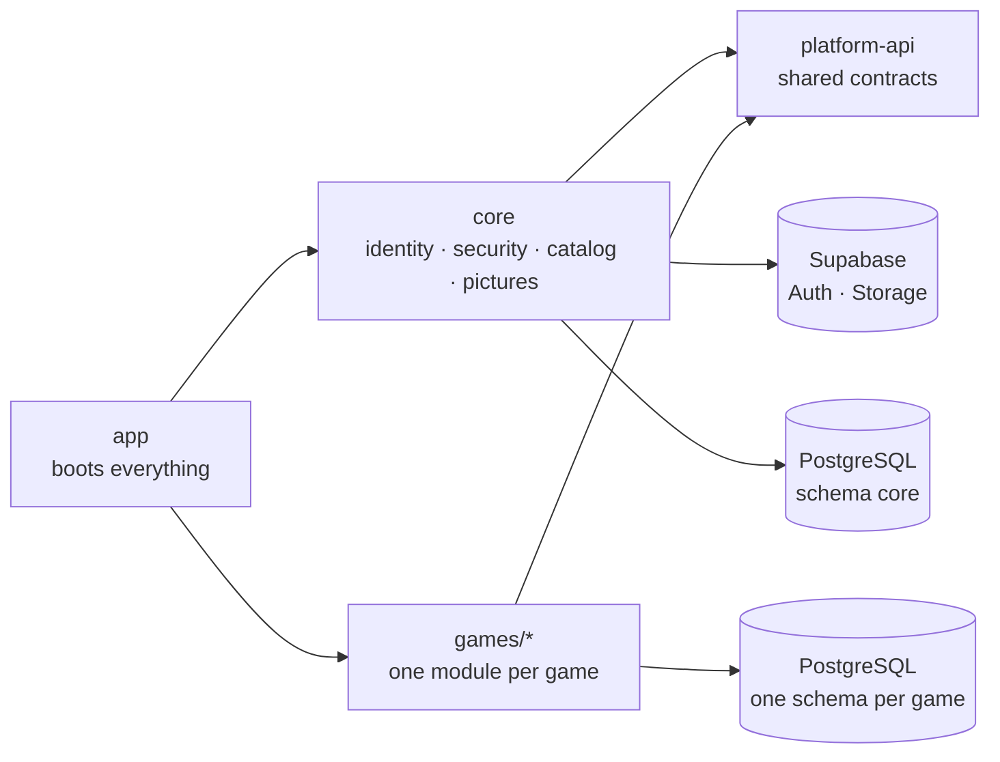

<div align="center">

# ⚙️ NTG System · Backend ⚙️

**REST API that handles identity, access control and the data of every game module.**


[Overview](#-overview) · [Folder structure](#-folder-structure) · [Security](#-security) · [Main flows](#-main-flows) · [API](#-api-overview) · [Data model](#-data-model) · [Free tiers](#-built-for-free-tiers) · [Errors & logs](#-errors-and-logging) · [Run & deploy](#-run-and-deploy)

↩️ [Back to the project overview](../README.md)

</div>

<br>

---
# ✨ Overview

The backend is a **Spring Boot** application split into Maven modules with one rule: **the platform never names
a game, and a game never depends on the platform**. Both only share a small module of contracts.

| Module | Role |
|---|---|
| 📜 **`platform-api`** | Contracts shared by everyone: who is calling, file storage, picture compression, public pictures, how a game declares itself (`GameModule`) and helpers for cacheable JSON. No Spring Security, no Supabase. |
| 🚀 **`core`** | The platform: identity (users, tags), the game catalog, public pictures, security, the Supabase integration, logging and error handling. It implements the contracts of `platform-api`. |
| 🎮 **`games/*`** | One module per game, with its own domain and REST endpoints. It depends **only on `platform-api`** and contains **no security code**: it declares its API path and tag, and `core` builds the access rules from that. |
| 🧷 **`app`** | Boots `core` and every game together and builds the runnable `ntg.jar`. Adding a game to the application is adding one dependency here. |



`Application` lives in the root package `com.adrianpmdev`, so Spring finds the components, entities and
repositories of every module on the classpath without listing them.

<br>

---
# 📁 Folder structure

The code is **feature-first**: each feature owns everything it needs, split into layers.

```text
backend/
├── pom.xml                         Parent POM: Java 25, versions, plugins, list of modules
├── Dockerfile                      Multi-stage build (Maven + JDK → slim JRE, non-root user)
├── .mvn/jvm.config                 JVM options of Maven
│
├── platform-api/                   📜 Contracts shared by core and the games
│   └── com/adrianpmdev/platform/
│       ├── port/                   CurrentUser, ObjectStorage
│       ├── module/                 GameModule: API path, tag and player writes of a game
│       ├── image/                  ImageCompressor, ImageSpec, CompressedImage
│       ├── asset/                  ImageSlot, ImageSlotProvider, PublicAssets
│       ├── error/                  ApiErrors (404, 409, 400, 403)
│       └── web/                    JsonResponses (JSON with ETag and cache rules)
│
├── core/                           🚀 The platform
│   ├── sql/core.sql                Schema core, public bucket and policies
│   └── com/adrianpmdev/core/
│       ├── config/                 Typed settings, OpenAPI, HTTP client, upload limits
│       ├── security/               🛡️ Who you are and what you may do
│       │   ├── config/             Security chains, CORS, token decoder
│       │   ├── authentication/     Principal, cached role and tags, Swagger admin login
│       │   ├── authorization/      Roles and tag-based authorities
│       │   ├── ratelimit/          Limits on sign-in attempts
│       │   ├── cookie/             Session (refresh token) cookie
│       │   └── filter/             Bearer token filter
│       ├── image/                  Picture compression (JDK only)
│       ├── integration/supabase/   🔌 Supabase Auth and Storage clients
│       ├── web/                    Health endpoint and global error handling
│       ├── logging/                Request id and access log
│       └── features/               auth · users · tags · catalog · assets
│
├── games/
│   ├── pokemon/                    🎮 Pokémon (+ sql/pokemon.sql)
│   └── wow-forever/                🎮 WoW Forever (no tables: data.json + config.json)
│
└── app/                            🧷 Application.java, application.yml, ntg.jar
```

### Inside every feature

```text
<feature>/
├── api/                            🌐 What the outside world sees
│   ├── controller/                 REST endpoints
│   ├── dto/request/                Validated input
│   ├── dto/response/               Explicit output (entities are never exposed)
│   └── mapper/                     Entity ⇄ DTO conversion (only where needed)
├── application/service/            🧠 Business rules and orchestration
├── domain/                         🧩 Pure rules without Spring (only where needed, e.g. Pokémon tournaments)
└── infrastructure/persistence/     🗄️ JPA entities and Spring Data repositories
```

**Rules that keep it tidy**

- Controllers never touch repositories: they call services, and services own the business rules.
- Requests are validated at the edge and responses are DTOs, so the database model never leaks into the API.
- A game only knows `platform-api`. When it needs something from the platform (who is calling, storing a file,
  compressing a picture) it uses one of those contracts and `core` provides the implementation.
- A game declares itself with a `GameModule` bean (API path, tag key, write routes open to players) and, if it
  needs public pictures, with an `ImageSlotProvider`. `core` reads those beans; it never has a game's name in it.

<br>

---
# 🛡️ Security

Every request goes through the same pipeline: request id and access log → CORS allow-list → optional bearer token
(verified locally, role and tags from a short cache) → deny-by-default authorization rules → controller. Requests
that are not signed in receive `401` and requests without permission receive `403`.

| 🔐 Concern | How it is handled |
|---|---|
| **Identity** | Delegated to **Supabase Auth**. The backend never stores passwords. |
| **Token verification** | Access tokens (JWT) are verified **locally**: signature, expiry, issuer and audience (`authenticated`, so only session tokens are accepted). No network call per request. |
| **Fresh permissions** | Role and tags are kept in memory for at most 60 seconds and evicted the moment an admin changes them, so a removed tag or a deleted user takes effect **immediately**. |
| **Authorization** | **Deny by default.** Every route must be listed; anything else is rejected. Game rules are built from the `GameModule` each game declares. |
| **Game access** | Reading a game's endpoints needs its **tag** (or admin); writing needs **admin**, except the routes a game opens to players. The tag of a game that is still *coming soon* is ignored for non-admins, so its API stays closed. |
| **Sign-in limits** | Login is limited per email, per client address and site-wide; session renewal and the email link per address. Too many attempts get `429` with `Retry-After`. |
| **Sessions** | Short-lived access token kept in memory by the client, plus a long-lived **refresh token in an HttpOnly cookie** (scoped to the auth path, `Secure` and `SameSite` configurable). The refresh token **rotates** on every use and logout revokes it on Supabase. |
| **Accounts** | **No public sign-up.** Only admins create users, and users choose their own password from a one-time email link. An admin cannot delete their own account. |
| **Passwords** | Policy enforced on the way in (length, at least a letter and a number). A failed login gives a generic message that does not say whether the email exists. |
| **Uploaded pictures** | Validated by their bytes, never by name. The server resizes and re-encodes every picture (which also drops metadata such as GPS), guards against huge images and processes one at a time. Private pictures (Pokémon teams) live in a bucket closed to clients and are shown through short-lived signed URLs. |
| **Database** | Row level security is enabled on every table, so the Supabase Data API can read nothing; the backend connects as the owner. |
| **Errors** | Standard problem-detail responses. Server errors return a generic message plus a **request id**, never stack traces, SQL or class names. |
| **Swagger** | Off by default; when an environment turns it on, it is protected with **Basic Auth** (admin only). |
| **Container** | The Docker image runs as an unprivileged user. |
| **Secrets** | Keys and credentials live **outside the repository** (environment variables or an ignored local file). |
| **Auditability** | Admin actions (users, tags, catalog, pictures…) are written to a dedicated `AUDIT` log. |

The web client adds its own browser protections on Vercel: a strict Content Security Policy, HSTS and the usual
security headers (see the [frontend documentation](../frontend/README.md)).

### Who can call what

| Area | Route | Access |
|---|---|---|
| Session | `POST /auth/login`, `/auth/refresh`, `/auth/logout`, `PUT /auth/set-password` | Public (the last one needs the link token), with attempt limits |
| Session | `GET /auth/me` | Any signed-in user |
| Profile | `PUT /users/me` | Any signed-in user (own profile only) |
| Catalog | `GET /games` | Any signed-in user (each sees the games they can) |
| Catalog | `POST` · `PUT` · `DELETE /games/**` | **Admin** |
| Users, tags, pictures | `/users/**`, `/tags/**`, `/assets/**` | **Admin** |
| Games | `GET /<game>/**` | Users with the game's **tag**, and admins |
| Games | Other methods on `/<game>/**` | **Admin**, except the routes the game opens to players |
| Health | `GET /keep-alive` | Public |
| Anything else | | ⛔ Denied |

<br>

---
# 🔄 Main flows

### 1. Creating a user (admin → email → password)

- An admin creates the user with an email, a username and tags. The account is created in Supabase without a
  password, the local profile and tags are saved, and Supabase sends an email with a one-time link.
- The user opens the link, chooses a password and is signed in right away.
- If saving the profile fails, the Supabase account is removed again, so no half-created users are left behind.
- If only the email fails (provider limits, for example), the user is still created and the admin is told, so the
  email can be **resent** later.

### 2. Staying signed in

- Login returns a short-lived access token (kept in memory by the client) and sets a long-lived refresh token in an
  HttpOnly cookie.
- When the page is reloaded or the access token expires, the client asks for a new one using only the cookie. The
  refresh token rotates on every use.

### 3. Games, tags and release

- Adding a game to the **catalog** also creates its tag. A new game starts as *coming soon*: listed for everyone,
  open only to admins.
- An admin assigns the tag to users and, when the game is ready, unticks *coming soon*. From the next request,
  users with the tag can read the game's API. No deploy is needed.

### 4. Pictures

- An admin uploads the original picture for a slot that a module declared (a game cover, a talent tree…). The
  server checks it, resizes it, re-encodes it as JPEG (PNG when it has transparency) and stores it in the public
  bucket. Its URL changes with every upload, so browsers can cache each version for a year.

<br>

---
# 🌐 API overview

All routes live under `/api/v1`.

| Module | Resources |
|---|---|
| **Auth** | `auth` (login, refresh, logout, set-password, me) |
| **Users** | `users` (create, list, update, delete, resend email), `users/{id}/tags`, `users/me` |
| **Tags** | `tags` |
| **Catalog** | `games` (the games each user can see, and their management) |
| **Pictures** | `assets` (expected pictures, upload, delete) |
| **Game modules** | One group of resources per game, under `/api/v1/<game>/...` |

Interactive documentation is available through Swagger UI where an environment enables it (admin only).

<br>

---
# 🗄️ Data model

PostgreSQL on Supabase, organised in schemas: **`core`** for the platform (users, tags, game catalog, pictures)
plus **one schema per game** that needs tables. Each module keeps its DDL next to its code
(`core/sql/core.sql`, `games/<game>/sql/`), and every file can be run again safely.

- Each user shares its id with its Supabase Auth account and is linked to its tags through a join table.
- A game owns the tables of its own schema and never exposes its entities: the API only returns DTOs.
- Data that only changes with a release (the WoW Forever game data, the Pokémon type chart) lives in JSON files
  inside the module, not in the database.
- Pictures are files in Supabase Storage; the database keeps only their object names.

<br>

---
# 🪶 Built for free tiers

The site runs on the free plans of Render, Vercel and Supabase, so the backend avoids work it does not need:

| Technique | Effect |
|---|---|
| **Role and tags cache** (Caffeine, 60 s) | At most one query per user per minute instead of one per request |
| **Catalog and picture URLs in memory** | Reloaded only after an admin changes them |
| **Gzip** | JSON is compressed (the WoW data drops from about 1.8 MB to about 200 KB) |
| **ETag on static JSON** | A browser that already has the data gets `304` with no body |
| **Daily `select 1`** | The keep-alive call touches the database once a day, so Supabase never pauses the project |
| **Small connection pool** | At most 5 connections to the Supabase pooler |
| **JVM tuned for 512 MB** | Limited heap, light garbage collector, restart on out-of-memory |

<br>

---
# 🧾 Errors and logging

**One consistent error format** (RFC 7807 problem details), with the field errors listed for validation failures
and a `requestId` that matches the logs:

```json
{
  "title": "Validation failed",
  "status": 400,
  "detail": "username: Username must have between 3 and 50 characters",
  "path": "/api/v1/users",
  "requestId": "a1b2c3d4e5f6"
}
```

**Readable logs on the console**, no log tables in the database. Every line carries the request id:

```text
12:30:01.123 INFO  [a1b2c3d4e5f6] ACCESS  POST /api/v1/auth/login -> 200 (143 ms)
12:31:10.456 INFO  [9f8e7d6c5b4a] AUDIT   actor=<admin> action=USER_CREATED target=<user> tags=[<game>]
```

- `ACCESS`: one line per request.
- `AUDIT`: who did what in the admin area.
- Client errors are warnings without stack traces; server errors are errors with the full trace.

<br>

---
# 🚢 Run and deploy

### Requirements

Java 25 and Maven 3.9. Settings without secrets are versioned in `app/src/main/resources/application.yml`
(compression, connection pool, Swagger off). Secrets come from a local `application.properties` next to it
(ignored by git) or from environment variables, which override the versioned file.

| Setting | Purpose |
|---|---|
| `spring.datasource.*` | PostgreSQL connection (Supabase) |
| `supabase.url`, `supabase.anon-key`, `supabase.service-role-key` | Supabase Auth and Storage access |
| `supabase.jwt.*` | How access tokens are verified (key set URL or shared secret, expected audience) |
| `app.frontend.url` | Where the email links point to |
| `app.cors.allowed-origins` | Origins allowed to call the API |
| `app.auth.*` | Session cookie options (`secure`, `same-site`, lifetime) |

```bash
mvn clean install                  # builds every module and runs the tests
java -jar app/target/ntg.jar       # starts the API on port 8080
```

From an IDE, run `com.adrianpmdev.Application` in the `app` module.

### Deployment

- A **multi-stage Dockerfile** builds the `app` module with Maven and JDK 25 and ships only `ntg.jar` on a slim
  JRE image, as an unprivileged user.
- Hosted on **Render**; the frontend on Vercel forwards `/api/*` to it.
- `GET /keep-alive` works as a health check and keeps the free instance awake.
- All environment-specific values come from the platform's environment variables.

<br>

---
# 🗺️ Ideas for next steps

- Real data for the admin dashboard.
- A screen for users to edit their own profile (the endpoint already exists).
- More automated tests for the account flows.
- More game modules following the same structure.

<br>

---

↩️ [Back to the project overview](../README.md) · 🖥️ [Frontend documentation](../frontend/README.md)
