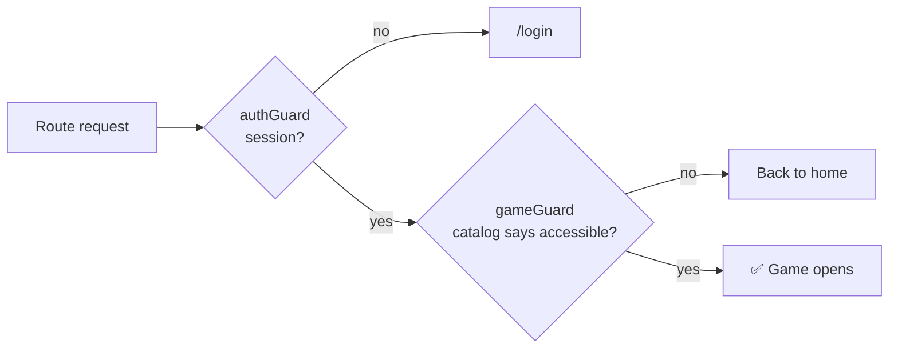

<div align="center">

# 🖥️ NTG System · Frontend 🖥️

### Single-page application for the NTG platform: sign in, pick a game, play and manage it


[](https://github.com/adrianpmdev)

[Overview](#-overview) · [Screens](#-screens) · [Access & routing](#-access-and-routing) · [Session](#-session-handling) · [Folder structure](#-folder-structure) · [Look & feel](#-look-and-feel) · [Conventions](#-conventions) · [Run & deploy](#-run-and-deploy)

↩️ [Back to the project overview](../README.md)

</div>

---

<br>

## ✨ Overview

The frontend is an **Angular 21** SPA that talks to the [NTG backend](../backend/README.md). It shows each user
only the games they have access to, and gives admins the tools to manage users, access, the game catalog, pictures
and game content.

- ⚡ **Modern Angular only:** standalone components, **zoneless** change detection, **signals**, lazy-loaded routes
  and `OnPush` on every component, with strict TypeScript and strict templates.
- 🪶 **Lean by choice:** no UI library and no state library. The only runtime dependencies are Angular and RxJS.
- 🧠 **The backend owns the data.** The game catalog, texts, rules and picture URLs come from the API; the web
  client only shows them and handles the interaction. Each response is requested once per session.
- 🧩 **One folder per game** under `src/app/games/`. A game never imports another game.
- 🔐 **Stays signed in** with silent session renewal, and never stores the access token on disk.
- 📱 **Works on every screen size:** each screen was checked from 320 px phones to desktop.
- 🎨 **Two visual worlds:** a terminal look for the platform, and a custom identity for each game.

> 🌍 **The interface is written in Spanish** (the audience is a Spanish-speaking group). Code and documentation are in
> English.

---

<br>

## 🧭 Screens

| Area             | Screen           | What it does                                                                                   |
| ---------------- | ---------------- | ---------------------------------------------------------------------------------------------- |
| 🔑 Auth          | **Login**        | Sign in; restores the session automatically if one exists                                      |
| 🔑 Auth          | **Set password** | Landing page of the email link: the user chooses a password and enters directly                |
| 🏠 Platform      | **Welcome**      | Player home: cards for the games they can open, and the ones coming soon                       |
| 👑 Admin         | **Dashboard**    | Platform overview                                                                              |
| 👑 Admin         | **Users**        | Create users by email, assign tags, edit, resend the password email, delete                    |
| 👑 Admin         | **Games**        | Game catalog: add a game (its tag is created too), order, cover, icon, release it to players   |
| 👑 Admin         | **Pictures**     | Every picture the platform and the games expect: upload the original, the server compresses it |
| 🎮 Games         | **Game areas**   | Each game has its own layout, theme, views and tools, and opens only with its tag              |
| 🎮 Games (admin) | **Management**   | A game can add its own administration screens to the admin area                                |

---

<br>

## 🚦 Access and routing

The backend says which games each user can open (`GET /games`); the app uses that answer to build the sidebar and
to guard the game routes. The backend enforces the same rules, the frontend only hides what a user cannot use.

| Route                                                               | Who can enter                                                                   | Layout                                           |
| ------------------------------------------------------------------- | ------------------------------------------------------------------------------- | ------------------------------------------------ |
| `/login`, `/set-password`                                           | Public                                                                          | Full-screen terminal                             |
| `/`                                                                 | Signed in                                                                       | Redirects: admin → dashboard, player → welcome   |
| `/welcome`                                                          | Signed in                                                                       | Terminal shell                                   |
| `/admin/dashboard`, `/admin/users`, `/admin/games`, `/admin/images` | Admin                                                                           | Terminal shell                                   |
| `/admin/<game>/**`                                                  | Admin                                                                           | Terminal shell (code lives in the game's folder) |
| `/<game>/**`                                                        | Signed in **and** allowed by the catalog (game released and tag held, or admin) | The game's own layout                            |



The routes of the games are generated from the list in `games/games.ts`: every game is served at `/<id>` and its
management area at `/admin/<id>`, so adding a game does not touch `app.routes.ts`.

---

<br>

## 🔁 Session handling

The session combines a short-lived access token kept in memory with a long-lived HttpOnly cookie.

- **No token on disk.** The access token lives in memory; the long session is kept by an **HttpOnly cookie** that
  scripts cannot read.
- **Reloads keep you signed in:** guards restore the session from the cookie before showing a page.
- **Silent renewal:** a timer renews the token shortly before it expires, and an HTTP interceptor renews and
  retries once if the API answers 401. Concurrent renewals share a single request.
- **Logout** closes the session on the backend and clears local state, including the cached catalog.
- **First-time access:** the invitation email opens `/set-password`; after choosing a password the user is signed
  in without going through the login screen.

---

<br>

## 📁 Folder structure

```text
frontend/
├── public/                     favicon.png (Team NTG logo: browser tab and sidebar)
├── proxy.conf.json             ng serve: /api → localhost:8080 (like Vercel does in production)
├── vercel.json                 /api rewrite, SPA fallback, cache and security headers
└── src/
    ├── main.ts · index.html · styles.scss
    ├── styles/                 Design tokens, breakpoints, reset, typography, terminal theme, shared admin styles
    └── app/
        ├── app.config.ts       Zoneless change detection, router, HTTP client + interceptor
        ├── app.routes.ts       Platform routes + one route per game, built from the games list
        │
        ├── core/               🧱 App-wide singletons, grouped by area
        │   ├── api/            API base URL
        │   ├── auth/           AuthSession, auth interceptor, auth · admin · role-home guards
        │   ├── games/          GameModule contract, GameCatalog, game guard
        │   ├── users/ · tags/ · assets/   UserApi, TagApi, AssetApi (pictures)
        │   └── notifications/  NotificationCenter
        │
        ├── shared/             ♻️ Reusable pieces (models, notification toasts, modal behaviour, API error helper)
        ├── layout/             🖼️ Terminal shell: sidebar, header, footer
        ├── features/           📦 Platform pages: auth, welcome, admin (dashboard, users, games, pictures)
        │
        └── games/              🎮 One folder per game
            ├── games.ts        The games built into this client
            └── <game>/
                ├── <game>.game.ts        Id, lazy routes and admin menu of the game
                ├── <game>.routes.ts      Player routes (+ admin routes if it needs management)
                ├── styles/               The game's own SCSS partial
                └── <views>/              Player views, tools and admin screens
```

### Adding a game

1. Create `games/<game>/` with its layout, theme, views, models and API service.
2. Export a `GameModule` from `<game>.game.ts` (id, routes, admin routes and menu) and list it in `games/games.ts`.
3. Add the game in the admin **Games** screen (this creates its tag), upload its cover and its icon (shown in the sidebar) and untick _coming soon_
   when it is ready.

The sidebar, the welcome page and the dashboard read the catalog from the backend, and the game's **id doubles as
the tag key** that unlocks it.

---

<br>

## 🎨 Look and feel

- **Platform areas** (login, welcome, admin) share a **terminal** aesthetic: monospaced type, neon accents and a
  command-line flavour.
- **Each game defines its own identity** inside its folder (custom properties, fonts and layout). The terminal
  styles are scoped, so they never leak into a game.
- **A game can reuse its components in both worlds.** Components written against the terminal tokens (as the
  Pokémon tournament views are) look green in the admin area and take the game palette inside the game layout,
  which re-points those tokens.
- **Responsive patterns:** shared breakpoints (900 / 640 / 420 px); admin tables become one card per row on
  phones; wide tables keep their first columns fixed while scrolling; brackets move a whole round per swipe;
  tooltips stay on screen on touch devices.
- Design tokens are CSS custom properties, and global feedback (success, error, warning) goes through a single
  notification service.

---

<br>

## 📐 Conventions

- **Dependency direction:** features and games may use `core`, `shared` and `layout`; `core` and `shared` never
  import from `features` or `games`; a game never imports from another game or from `features`.
- **Locality first:** a file used by one area stays inside it and only moves to `core` or `shared` when two areas
  need it.
- **Naming:** hyphen-separated file names, one base name per component (`.ts`, `.html`, `.scss`), no type
  suffixes, selector prefix `app-`. Services are named for what they do (`AuthSession`, `GameCatalog`, `UserApi`),
  guards and interceptors keep their type with a hyphen (`auth-guard.ts`, `auth-interceptor.ts`) and event handlers
  are named for their action (`signIn()`, `uploadPicture()`), never `onClick()`.
- **Visibility:** members used only by a component's template are `protected`, members used only by the class are
  `private`; inputs, outputs and anything other files use stay public.
- **Modals:** every modal backdrop uses the `appModalOverlay` directive, which closes it with Escape or a click
  outside, keeps focus inside the dialog, names it after its title and gives focus back when it closes.
- **Path aliases:** `@core`, `@shared`, `@layout`, `@features`, `@games`.
- Every `.ts` file starts with a short English header comment, and there are no other comments in the code,
  styles or templates.
- **Linting and formatting:** ESLint with the angular-eslint rules (including template accessibility) and Prettier
  (120 columns, 4 spaces, single quotes) must pass before a change is merged.

---

<br>

## 🚢 Run and deploy

```bash
npm install
npm start          # development server on http://localhost:4200 (start the backend on :8080 first)
npm run build      # production build
npm run lint       # ESLint (angular-eslint, template accessibility)
npm run format     # format the project with Prettier (format:check only checks it)
```

- **One API address everywhere:** the app always calls the relative `/api/v1`. In development `ng serve` forwards
  it to `localhost:8080` (`proxy.conf.json`); in production Vercel forwards it to the backend. No environment
  files are needed.
- **Hosting:** deployed on **Vercel** from `main`. `vercel.json` rewrites `/api/*` to the backend, falls back to
  `index.html` for client-side routes, caches the hashed JS and CSS for a year and sends the security headers
  (Content Security Policy, HSTS, `nosniff`, frame protection, referrer and permissions policies).
- **Why the rewrite:** the browser only talks to the site's own domain, so the session cookie is **first-party**
  (it also works in browsers that block third-party cookies) and the backend address is never exposed to the app.

---

<br>

## 🗺️ Ideas for next steps

- Real data for the admin dashboard.
- A screen for users to edit their own profile.
- Automated tests for guards, interceptor and key screens.
- More game modules following the same structure.

---

<br>

↩️ [Back to the project overview](../README.md) · ⚙️ [Backend documentation](../backend/README.md) · 📄 [License](../LICENSE)

---

<br>

<div align="center">

✨ Made in **2026** by [@adrianpmdev](https://github.com/adrianpmdev) ✨

</div>
