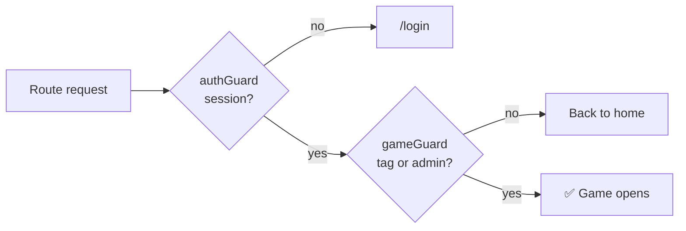

<div align="center">

# 🖥️ NTG System · Frontend 🖥️

**Single-page application for the NTG platform: sign in, pick a game, play and manage it.**


[Overview](#-overview) · [Screens](#-screens) · [Access & routing](#-access-and-routing) · [Session](#-session-handling) · [Folder structure](#-folder-structure) · [Look & feel](#-look-and-feel) · [Conventions](#-conventions) · [Run & deploy](#-run-and-deploy)

↩️ [Back to the project overview](../README.md)

</div>

<br>

---
# ✨ Overview

The frontend is an **Angular 21** SPA that talks to the [NTG backend](../backend/README.md). It shows each user
only the games they have access to, and gives admins the tools to manage users, access and game content.

- ⚡ **Modern Angular only:** standalone components, **zoneless** change detection, **signals**, lazy-loaded routes
  and `OnPush` on every component, with strict TypeScript and strict templates.
- 🪶 **Lean by choice:** no UI library and no state library. The only runtime dependencies are Angular and RxJS.
- 🧩 **One folder per game.** Adding a game means adding a feature folder and one entry in a central list.
- 🔐 **Stays signed in** with silent session renewal, and never stores the access token on disk.
- 🎨 **Two visual worlds:** a terminal look for the platform, and a custom identity for each game.

> The interface is written in Spanish (the audience is a Spanish-speaking group). Code and documentation are in
> English.

<br>

---
# 🧭 Screens

| Area | Screen | What it does |
|---|---|---|
| 🔑 Auth | **Login** | Sign in; restores the session automatically if one exists |
| 🔑 Auth | **Set password** | Landing page of the email link: the user chooses a password and enters directly |
| 🏠 Platform | **Welcome** | Player home: cards for the games they can open |
| 👑 Admin | **Dashboard** | Platform statistics |
| 👑 Admin | **Users** | Create users by email, assign tags, edit, resend the password email, delete |
| 🎮 Games | **Game areas** | Each game has its own layout, theme, views and tools, and opens only with its tag |
| 🎮 Games (admin) | **Management** | Each game can add its own administration screens to the admin area |

<br>

---
# 🚦 Access and routing

The backend returns the user's **role** and **tags**; the app uses them to decide what to show. The backend
enforces the same rules, the frontend only hides what a user cannot use.

| Route | Who can enter | Layout |
|---|---|---|
| `/login`, `/set-password` | Public | Full-screen terminal |
| `/` | Signed in | Redirects: admin → dashboard, player → welcome |
| `/welcome` | Signed in | Terminal shell |
| `/admin/dashboard`, `/admin/users` | Admin | Terminal shell |
| `/admin/<game>/**` | Admin | Terminal shell (code lives in the game's feature) |
| `/<game>/**` | Signed in **and** has the game's tag (admins always) | The game's own layout |



Guards: `authGuard`, `adminGuard`, `roleHomeGuard` and `gameGuard(gameId)`.

<br>

---
# 🔁 Session handling

The session combines a short-lived access token kept in memory with a long-lived HttpOnly cookie.

- **No token on disk.** The access token lives in memory; the long session is kept by an **HttpOnly cookie** that
  scripts cannot read.
- **Reloads keep you signed in:** guards restore the session from the cookie before showing a page.
- **Silent renewal:** a timer renews the token shortly before it expires, and an HTTP interceptor renews and
  retries once if the API answers 401. Concurrent renewals share a single request.
- **Logout** closes the session on the backend and clears local state.
- **First-time access:** the invitation email opens `/set-password`; after choosing a password the user is signed
  in without going through the login screen.

<br>

---
# 📁 Folder structure

```text
frontend/
├── public/                     Static assets served by URL (images, game artwork)
├── scripts/                    Build-time environment generator
├── vercel.json                 SPA fallback + /api rewrite to the backend
└── src/
    ├── main.ts · index.html · styles.scss
    ├── styles/                 Design tokens, mixins, reset, typography, terminal theme
    └── app/
        ├── app.config.ts       Zoneless change detection, router, HTTP client + interceptor
        ├── app.routes.ts       Lazy-loaded top-level routes
        │
        ├── core/               🧱 App-wide singletons
        │   ├── config/         API base URL and the list of games
        │   ├── services/       Auth, users, tags, notifications
        │   ├── interceptors/   Token handling and silent session renewal
        │   └── guards/         auth · admin · role-home · game
        │
        ├── shared/             ♻️ Reusable pieces (models, notification toasts)
        ├── layout/             🖼️ Terminal shell: sidebar, header, footer
        │
        └── features/           📦 One folder per area of the site
            ├── auth/           Login and set password
            ├── welcome/        Player home
            ├── admin/          Dashboard and user management (with tags)
            └── <game>/         🎮 One folder per game
                ├── <game>-layout/        Own shell and theme
                ├── <views>/              Player views and tools
                └── admin/                Game management (if needed)
```

### Adding a game

1. Create `features/<game>/` with its own layout, theme, views, models and services.
2. Add its routes (`<game>.routes.ts`, plus an admin routes file if it needs management).
3. Register them in `app.routes.ts` and add one entry to the games list in `core/config/games.ts`.

The sidebar, the welcome page and the dashboard read from that list, and the game's **id doubles as the tag
key** that unlocks it on the backend.

<br>

---
# 🎨 Look and feel

- **Platform areas** (login, welcome, admin) share a **terminal** aesthetic: monospaced type, neon accents and a
  command-line flavour.
- **Each game defines its own identity** inside its feature (custom properties, fonts and layout). The terminal
  styles are scoped, so they never leak into a game.
- Design tokens are CSS custom properties, and global feedback (success, error, warning) goes through a single
  notification service.

<br>

---
# 📐 Conventions

- **Dependency direction:** features may use `core`, `shared` and `layout`; `shared` never imports from
  `features`; a feature never imports from another feature.
- **Locality first:** a file used by one feature stays inside it and only moves to `core` or `shared` when two
  features need it.
- **Naming:** hyphen-separated file names, one base name per component (`.ts`, `.html`, `.scss`), no type
  suffixes, selector prefix `app-`.
- **Path aliases:** `@core`, `@shared`, `@layout`, `@features`.
- Every file starts with a short English header comment.

<br>

---
# 🚢 Run and deploy

```bash
npm install
npm start          # development server on http://localhost:4200
npm run build      # production build
```

- **Environments:** the API address is generated at build time (`scripts/generate-env.js`). In production it is a
  **relative `/api/v1`**; in local development it points to the backend on `localhost`.
- **Hosting:** deployed on **Vercel**. `vercel.json` rewrites `/api/*` to the backend and falls back to
  `index.html` for client-side routes.
- **Why the rewrite:** the browser only talks to the site's own domain, so the session cookie is **first-party**
  (it also works in browsers that block third-party cookies) and the backend address is never exposed to the app.

<br>

---
# 🗺️ Ideas for next steps

- Automated tests for guards, interceptor and key screens.
- A tag management screen for admins.
- Player names and avatars in the game views.
- More game modules following the same structure.

<br>

---

↩️ [Back to the project overview](../README.md) · ⚙️ [Backend documentation](../backend/README.md)
